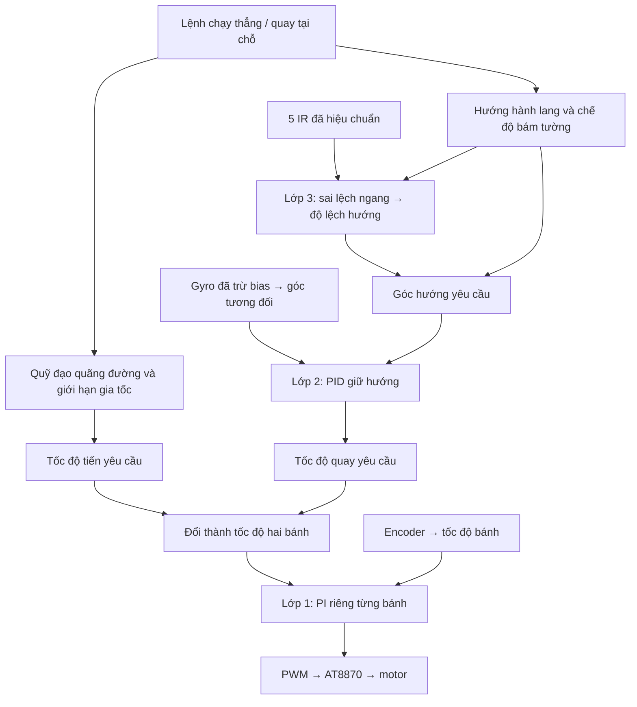

# Micromouse F405 — C++ điều khiển ba lớp và test chuyển động

Dự án mới dành cho **STM32F405RGT6 + 2 AT8870 + 2 MT6701 A/B + ICM20602 chỉ gyro + 5 IR / 3 MOSFET phát**. Bộ `hardware-tests/` được lưu riêng để test module. Không compile hai bộ ứng dụng chung một firmware vì chúng cùng sở hữu timer, ADC và SPI.

Đây là **mã ứng dụng C++17, driver STM32 HAL và project kiểm thử trên PC**. Phần startup, linker, HAL và file `.ioc` cần được CubeMX sinh theo hướng dẫn [CUBEMX.md](docs/CUBEMX.md). Chưa có binary ARM đã kiểm chứng trên bo thật. Không có giả định rằng chỉ copy source là nạp được ngay.

## Bắt đầu từ đâu

1. Đọc [CUBEMX.md](docs/CUBEMX.md), tạo project MCU **STM32F405RGT6**, cấu hình đúng ngoại vi và thêm source theo hướng dẫn.
2. Đọc [TUNING.md](docs/TUNING.md), kiểm tra chiều motor/encoder/gyro, đo số đếm mỗi vòng bánh, hiệu chuẩn gyro và IR.
3. Chỉnh `platform/board_config.cpp`: chân đã điền theo phương án thống nhất; **metres_per_count và PI đang bằng 0, hai cờ xác nhận đang false**. Vì chưa biết thông số cơ khí thực, firmware từ chối chạy kín vòng cho đến khi bạn điền chúng.
4. Test xung motor và cảm biến trước, sau đó PI tốc độ, giữ hướng, chạy thẳng, quay ±90°, cuối cùng bám tường.

## Kết nối phần cứng thực

Nếu chưa có PCB và chỉ cắm một vài module, dùng project `hardware-tests` theo README của bộ đó. Hướng dẫn ở phần này dành cho firmware điều khiển đầy đủ `micromouse-control`; không dùng các lệnh arm/PID này cho firmware bench.

### Chuẩn bị và cấp nguồn

- Core board STM32F405RGT6; ST-Link để nạp/debug; USB–UART có **mức tín hiệu 3.3V** để gửi lệnh.
- Hai AT8870, hai motor, hai encoder MT6701 có A/B, ICM20602 có SPI, mạch phát/thu IR như cấu hình. Với module mua sẵn, kiểm tra pinout và điện áp thực của module trước khi nối.
- Nguồn motor cấp vào **VM của driver**, nguồn logic cấp qua bộ ổn áp/đầu vào hợp lệ của core board và cảm biến. Không đưa pin 2S trực tiếp vào chân 3V3/5V hoặc GPIO.
- Không cấp motor từ chân 3.3V của MCU, ST-Link hoặc USB–UART. Mức điện áp motor và giới hạn dòng phải theo motor/đúng biến thể AT8870 đang có; chưa biết thông số N20 thì chưa chốt được các giá trị đó.
- Nối GND MCU, cảm biến và driver. Đường hồi dòng motor dùng dây/đường mạch phù hợp về nguồn, tránh đi xuyên đường GND mảnh của cảm biến. Đặt tụ nguồn theo datasheet/module gần driver và IMU.
- Khi dùng module F405 có USB-C, chưa xác minh được cách nối nguồn bên trong thì không đấu song song USB và nguồn ngoài một cách mặc định. Chọn một đường cấp nguồn logic đã kiểm tra, tránh cấp ngược giữa các nguồn.

Tắt nguồn trước khi đổi dây. Đo đường logic bằng đồng hồ trước khi cắm cảm biến; kiểm tra cực nguồn và chạm chập. Dây motor dùng đầu nối phù hợp dòng thực, không dùng đường breadboard tín hiệu làm đường cấp motor.

### ST-Link và USB–UART

| Đầu nối thiết bị | Chân phía F405 | Ghi chú |
|---|---|---|
| ST-Link SWDIO | PA13 / DIO | Chọn SYS Debug = Serial Wire |
| ST-Link SWCLK | PA14 / CLK | Không tái sử dụng làm GPIO khác |
| ST-Link GND | GND | GND chung |
| ST-Link NRST nếu có | NRST / NR | Hữu ích khi cần connect under reset |
| ST-Link VTref nếu có | Rail logic 3.3V của bo | Điện áp tham chiếu; phân biệt với chân nguồn 3.3V của từng loại ST-Link |
| USB–UART RX | PC10 / USART3_TX | Nối chéo TX → RX |
| USB–UART TX | PC11 / USART3_RX | Tín hiệu mức 3.3V |
| USB–UART GND | GND | Khi bo đã có nguồn riêng, chỉ cần TX/RX/GND, không nối VCC adapter |

Kiểm tra sơ đồ của đúng ST-Link/adapter; vị trí chân trên các bản clone có thể khác nhau. Firmware này **chưa có USB CDC**, nên cắm USB-C vào core board không tự tạo cổng COM cho menu test. Nếu ST-Link của bạn có VCP, chỉ dùng thay USB–UART khi đã xác định đúng chân VCP và nối chúng tới PC10/PC11.

Tham khảo [ST-Link UM1075](https://www.st.com/resource/en/user_manual/um1075-stlinkv2-incircuit-debuggerprogrammer-for-stm8-and-stm32-stmicroelectronics.pdf) và [datasheet STM32F405](https://www.st.com/resource/en/datasheet/stm32f405rg.pdf). Tên PA/PB/PC dưới đây là GPIO MCU, không phải số chân J97/J100 trên bo cắm; kiểm tra silkscreen và thông mạch.

### Bảng dây tín hiệu

| Phần cứng | Chân module / tín hiệu | Nối F405 |
|---|---|---|
| AT8870 trái | IN1 / IN2 | PB4 / PB5 |
| AT8870 phải | IN1 / IN2 | PB6 / PB7 |
| Mỗi AT8870 | OUT1 / OUT2 | Hai đầu motor tương ứng, không nối MCU |
| MT6701 trái | A / B | PC6 / PC7 |
| MT6701 phải | A / B | PA0 / PA1 |
| ICM20602 | CS | PB12 |
| ICM20602 | SCK / SCL khi dùng SPI | PB13 |
| ICM20602 | SDO / MISO | PB14 |
| ICM20602 | SDI / SDA khi dùng SPI | PB15 |
| ICM20602 | INT | PB8 dự phòng; bản này không cần nối để polling |
| Phát IR hông | Gate mạch MOSFET Q6 | PC1, điều khiển hai LED của IR1/IR5 |
| Phát IR chéo | Gate mạch MOSFET Q8 | PA5, điều khiển hai LED của IR2/IR4 |
| Phát IR trước | Gate mạch MOSFET Q7 | PC2, điều khiển LED của IR3 |
| Thu IR1 / IR2 / IR3 / IR4 / IR5 | Điện áp analog | PA3 / PA4 / PB0 / PB1 / PC0 |
| Nút Start / Mode | Nút nhấn nối xuống GND | PC9 / PC8, pull-up theo mạch |

MT6701 phải xuất A/B; module chỉ có SSI/I²C không dùng trực tiếp với timer encoder. Module IMU phải đúng ICM20602; MPU6050/6500/9250 không được thay vào chỉ bằng đổi tên hoặc bỏ kiểm tra ID.

Mỗi LED phát IR cần điện trở hạn dòng và tầng công suất phù hợp; GPIO điều khiển gate, không trực tiếp cấp dòng LED. Mỗi mắt thu cần mạch tạo điện áp analog trong dải ADC. Chân DO của module IR so sánh số không thay được tín hiệu analog; module có LED luôn sáng cũng chưa tương thích phép đo bật/tắt nếu không có cách điều khiển emitter. Không mặc định chân VCC của mọi breakout đều chịu được 5V.

Giữ SPI và dây tín hiệu ngắn khi thử trên dây rời, tránh bó chung với dây motor. Dùng sơ đồ của breakout để nhận diện các nhãn SDA/SDI và SDO/AD0; chúng có thể đổi chức năng theo giao thức. Với bare chip, vẫn phải có đủ chân nguồn, GND/reserved và tụ theo datasheet, không chỉ nối bốn dây SPI.

## Nạp và vận hành trên robot thật

### Lần cấp nguồn đầu

1. Đối chiếu dây/PCB với bảng trên và `platform/board_config.cpp`. Nếu đường mạch thực khác, phải đổi dây hoặc đổi cả CubeMX lẫn cấu hình code tương ứng.
2. Để nguồn motor tắt, cấp nguồn logic đã kiểm tra. Nối ST-Link và USB–UART; không lấy nguồn motor từ hai thiết bị này.
3. Tạo/generate project CubeMX theo [CUBEMX.md](docs/CUBEMX.md), thêm source C++, hook TIM6/UART và build bằng toolchain ARM. Các executable trong `build/Release` của CMake host không nạp được lên STM32.
4. Nạp firmware từ project CubeIDE, cho CPU chạy liên tục. Reset không được tự làm motor quay.
5. Mở đúng COM,115200 baud,8 data bits,no parity,1 stop bit,no flow control; tắt local echo nếu gây khó đọc. Gửi `h` một lần. Có thể gửi ký tự riêng; CR/LF được bỏ qua.
6. Nếu không có log, kiểm tra nguồn/GND, COM, TX/RX nối chéo và USART3 IRQ trước khi cấp nguồn motor. Nếu `MM_Init()` trả 0, debug nguyên nhân init thất bại; không bỏ kiểm tra để ép chạy.

### Xác nhận cảm biến rồi mới thử motor

| Thao tác thực tế | Kết quả cần thấy |
|---|---|
| Quay riêng bánh trái/phải bằng tay | Cột Lcount/Rcount tương ứng thay đổi; bánh tiến phải có count tăng sau khi chỉnh sign |
| Đưa tường gần từng mắt IR | IR1…IR5 tương ứng thay đổi; xem thêm on/off trong `firmware::diagnostics` để phát hiện bão hòa |
| Xem gyro bằng debugger | `who_am_i=0x12`, `gyro_samples` tăng, raw đổi khi xoay module |
| Gửi `c`, giữ robot đứng yên | Sau khoảng 2000 mẫu mới, CSV `cal=1`; nếu lỗi xem `calibration_failed` và `gyro_std` |
| Nhấc bánh, cấp nguồn motor; gửi `b` rồi `1` | Chỉ bánh trái chạy một xung chiều + rồi tự dừng |
| Tiếp tục `b` rồi `2`, `b` rồi `3`, `b` rồi `4` | Đúng bánh/chiều; mỗi lệnh cần arm lại |
| Gửi `s` hoặc SPACE | PWM về 0; motor có thể còn trôi do quán tính |

Không cần nhập gain PI để test xung thô. Dấu '+' là quy ước điện ban đầu: xác nhận chiều thật rồi sửa `motors[i].sign`, encoder sign và gyro sign đúng từng phần. Trong xung thô, cột duty của controller không biểu diễn duty xung; xem CCR hoặc đo PWM.

### Đặt xuống sàn và test PID

Chỉ thực hiện sau khi đã đo m/count riêng mỗi bánh, khoảng cách hai bánh, kiểm tra dấu, nhập PI và đặt hai cờ xác nhận cấu hình. Không bật cờ xác nhận chỉ để vượt khóa chạy. Hướng dẫn đo/tune chi tiết: [TUNING.md](docs/TUNING.md).

1. Chọn vùng trống, phẳng; giữ cách cắt nguồn motor trong tầm tay. `front_guard` hiện mặc định tắt nên robot chưa tự tránh vật cản.
2. Nếu vừa reset MCU, gửi `c` và chờ `cal=1`. Có thể dùng `r` lúc dừng để đặt lại góc tương đối, nhưng `r` không thay hiệu chuẩn gyro.
3. Gửi `e`, kiểm tra `cmd=1`, rồi `p`: test PI 0.05m/s mỗi bánh trong 1s. Nếu có lỗi thì xử lý trước khi chuyển bài.
4. Gửi `e`, rồi `f`: tiến 180mm. Chờ `state=4` (Complete), đo quãng thực sau khi robot đã dừng cơ học. Nếu `state=5` là Fault, không coi đó là hoàn tất.
5. Gửi `e`, rồi `L` hoặc `R`: quay tại chỗ ±90°. Đo bằng mốc góc thực và lặp nhiều lần; không tự bù bằng đổi lệnh 90° khi chưa tìm nguyên nhân sai.
6. Sau khi đã đo LUT IR và tune giữ hướng, gửi `e`, rồi `w` để thử bám tường. Dùng hành lang đơn giản trước khi thử cửa tường/giao lộ.

`cmd=1` chỉ xác nhận nhận lệnh, không xác nhận chuyển động thành công. Không gửi dồn nhiều lệnh. Khi có fault, dùng `s`, xem mã lỗi trong [TUNING.md](docs/TUNING.md), xử lý nguyên nhân rồi `r`. Driver gyro lỗi bus cần kiểm tra dây và reset MCU để init lại; lỗi UART cũng cần khôi phục kết nối/reset, không chỉ gửi `r`.

Nút Mode chỉ chọn bài, chưa chạy; chọn xong cần `e` trước khi bấm Start. Nút không phải công tắc cắt nguồn khẩn: phần mềm/nguồn có lỗi vẫn cần ngắt nguồn motor bằng phần cứng. Không đặt breakpoint/single-step khi đang cấp xung motor hoặc LED; xem giới hạn watchdog ở phần dưới.

### Lỗi thường gặp khi nối thật

| Hiện tượng | Kiểm tra theo thứ tự |
|---|---|
| Terminal không có chữ | Nguồn logic, GND chung, đúng COM, TX/RX,1152008N1, USART3 IRQ, CPU đang Run |
| `e` hoặc bài chạy bị từ chối | Cấu hình còn 0/false, gyro chưa zero, fault còn giữ, robot đang chuyển động, thiếu LUT nếu chọn wall mode |
| Motor không quay ở xung 12% | VM và giới hạn dòng, đúng IN/OUT, đúng kênh PWM, cơ khí/ma sát; không tăng duty ngay khi chưa đo điện |
| Encoder đứng count | Chế độ A/B, nguồn/logic, vị trí nam châm, CH1/CH2 đúng timer; không dùng SSI/I²C thay A/B |
| WHO không phải 0x12 | Đúng chip, CS idle HIGH, MISO/MOSI, mode SPI, nguồn và GND |
| IR không đổi hoặc bão hòa | Cực LED, điện trở, gate MOSFET, đầu ra AO thay vì DO, đúng ADC, điện áp và ánh sáng nền |
| Chạy motor thì reset/lỗi gyro | Sụt nguồn, đường hồi dòng, tụ gần driver/IMU, dây SPI gần dây motor |
| Fault Timing | Xem period/work time/missed_ticks; loại delay/log blocking, kiểm tra clock và TIM6; không tắt kiểm tra thời gian để che lỗi |

Kết thúc phiên test: gửi `s`, chờ bánh dừng, ngắt nguồn motor trước khi tháo dây; ngắt nguồn logic trước khi thay module. Ghi lại cấu hình, số đo, pin/mặt sàn và log để so sánh lần tune sau.

## Cấu trúc theo sơ đồ của bạn



| File | Trách nhiệm |
|---|---|
| `include/mm/config.hpp` | Thông số SI, giới hạn, gain, kiểu bảng hiệu chuẩn IR |
| `include/mm/pid.hpp` | PID có giới hạn tích phân, chống wind-up, lọc nhánh D |
| `include/mm/controller.hpp` | API điều khiển, dữ liệu vào, trạng thái và mã lỗi |
| `src/controller.cpp` | Quãng đường, ba lớp điều khiển, mixer, hoàn tất/dừng/lỗi |
| `platform/board_config.hpp/.cpp` | Gán GPIO/handle/channel, dấu chiều, thông số robot |
| `platform/stm32_platform.hpp/.cpp` | PWM, encoder, SPI gyro, zero gyro, ADC quét ba nhóm |
| `platform/micromouse_app.h/.cpp` | Scheduler, UART, nút, watchdog, API C gọi từ `main.c` |
| `tests/control_tests.cpp` | Mô phỏng plant hai motor và lỗi điều khiển |
| `tests/platform_tests.cpp`, `tests/hal_mock/` | Compile adapter và kiểm thử giao tiếp bằng HAL giả |

Phần điều khiển và driver có comment tiếng Việt. Thay đổi chân ở `board_config.cpp` **phải đi kèm thay đổi CubeMX**; handle không tự thiết lập Alternate Function.

## Các hàm test chính

```cpp
// Chỉ gọi trong main, sau MM_Init() và nhiều lượt MM_Poll().
MM_CalibrateGyro();               // Bắt đầu thu 2000 mẫu mới; không chờ tại đây.
// Đợi diagnostics.calibrated == true; vẫn gọi MM_Poll() liên tục.

MM_ArmMotion();                   // Chỉ thành công sau khi đã điền/kiểm tra cấu hình.
MM_TestStraight(0.18f, 0);        // Tiến 180mm, giữ hướng bằng gyro, không bám tường.

// Đợi kết thúc trước lệnh tiếp; kiểm tra return của MỌI hàm.
MM_ArmMotion();
MM_TestTurn90(1);                 // Quay trái tại chỗ +90°.
MM_ArmMotion();
MM_TestTurn90(0);                 // Quay phải tại chỗ -90°.

MM_ArmMotion();
MM_TestStraight(0.18f, 1);        // Bám tường tự động: cần LUT của IR1 và IR5.
MM_ArmMotion();
MM_TestWheelSpeed(0.05f,0.05f,1); // Test PI: 0.05m/s mỗi bánh trong 1 giây.
MM_Stop();                       // Dừng output, không tự xóa fault.
```

Đây là minh họa API, **không dán nguyên chuỗi này vào main để gọi liên tiếp**. Mỗi lệnh cần kết thúc trước lệnh tiếp, mỗi lần chạy cần arm lại. API trả `1` khi nhận, `0` khi từ chối. Không gọi các hàm test từ ISR. `MM_TestTurn()` nhận góc tương đối theo độ, giới hạn ±180°; `MM_TestStraight()` nhận mét, giới hạn ±2m; lùi không hỗ trợ bám tường. Quay 90° ở đây là **quay tại chỗ**, chưa phải cua chạy liên tục/slalom.

## Dùng UART 115200 8N1

| Lệnh | Hành động |
|---|---|
| `h` | In trợ giúp và header CSV |
| `c` | Hiệu chuẩn zero gyro khi robot đứng yên |
| `r` | Reset controller khi đang dừng; xóa fault và góc tương đối, giữ bias gyro |
| `e` | Arm một lệnh kín vòng, không làm motor quay ngay |
| `f` | Chạy thẳng 180mm, không bám tường |
| `L` / `R` | Quay trái/phải 90° tại chỗ |
| `w` | Chạy thẳng 180mm với bám tường tự động |
| `p` | Test PI hai bánh 0.05m/s trong 1s |
| `b` | Arm một xung motor thô, không cần gain/scale encoder |
| `1` / `2` | Xung motor trái tiến/lùi |
| `3` / `4` | Xung motor phải tiến/lùi |
| `s` hoặc SPACE | Dừng ngay qua UART RX ISR, hủy arm và lệnh đang chạy |

Ví dụ: `b`, rồi `1`; xem chiều bánh và count. Sau khi có thông số thật: `c`, đợi zero xong, `e`, `p`; tiếp theo `e`, `f`. Gõ từng lệnh và kiểm tra kết quả, không gửi một chuỗi lệnh di chuyển dài.

Xung motor thô mặc định duty 12%, 300ms; N20 có thể chưa thắng ma sát ở mức này. Bảng CSV vẫn hiển thị `state=Idle` và duty của **controller**, nên không dùng cột duty đó để suy ra xung thô. Xem trực tiếp CCR khi test xung. Trong lúc xung thô, encoder/gyro/IR vẫn được đọc; gyro thiếu không ngăn riêng test thô.

Nút Mode PC8 chọn lần lượt thẳng → trái90 → phải90 → thẳng bám tường. Nút Start PC9 chỉ chạy sau `e`; nhấn Start trong lúc test sẽ dừng. Hai nút debounce 20ms, polling, không dùng EXTI. Firmware không tự arm khi cấp nguồn hoặc reset.

## Quy ước và các lớp

- Trái/phải theo hướng robot nhìn về phía trước; tốc độ bánh dương là chạy tiến.
- Góc và tốc độ quay dương là quay trái, nhìn từ trên; đơn vị rad, rad/s.
- Encoder tích lũy count x4, xử lý tràn 16/32 bit. Hai bánh có hệ số m/count riêng.
- Vòng nền mục tiêu 1kHz; vòng hướng 250Hz; vòng tường 100Hz; IR mục tiêu 500 frame/s; log 10Hz.
- Góc là tích phân gyro tương đối, không dùng accel, không có góc la bàn tuyệt đối. Bias và scale phải đo, drift vẫn tồn tại.
- Giữ hướng dùng đạo hàm lỗi gần bằng `-gyro`, tránh xung D khi đổi setpoint. Vòng tường có hysteresis và giới hạn độ lệch hướng.
- Quãng đường điều khiển dùng trung bình quãng lăn hai bánh; không phải tọa độ toàn cục theo trục hành lang. Trượt bánh gây sai quãng đường.
- IR2/IR4 được quét, hiệu chuẩn và xuất dữ liệu; phiên bản này dùng IR1/IR5 cho bám tường, IR3 cho dừng trước vật cản nếu bật. Chưa dùng IR chéo để nhận diện góc mê cung.

## Dừng và phạm vi bảo vệ

Core dừng khi mất gyro, lỗi cảm biến, vượt thời gian lệnh, trễ chu kỳ, bánh kẹt hoặc đếm ngược. Dữ liệu IR lỗi/cũ chỉ làm dừng motion khi đang dùng IR. Mất tường hợp lệ chuyển dần về hướng gốc; khác với bus ADC bị lỗi. Fault giữ lại đến `r`/reset. SPI lỗi khóa driver gyro; cần kiểm tra dây rồi reset MCU để init lại, `r` không sửa bus.

TIM6 ISR cắt PWM nếu main không phục vụ khoảng 5ms. Không bảo vệ được khi toàn bộ ngắt bị khóa, MCU mất clock hoặc CPU bị debugger halt; đọc hướng dẫn IWDG trong CubeMX. Coast là IN1=IN2=0, robot không dừng cơ học tức thời. **Front guard mặc định tắt vì chưa có số đo IR**; test ban đầu trong vùng trống, nâng bánh khi kiểm tra chiều. Phần mềm không thay thế giới hạn dòng của AT8870.

## Build và kiểm thử trên PC

```text
cmake -S micromouse-control -B micromouse-control/build
cmake --build micromouse-control/build --config Release
ctest --test-dir micromouse-control/build -C Release --output-on-failure
```

Project CMake ở đây build host test, **không build ELF cho STM32**. Xem [VALIDATION.md](docs/VALIDATION.md) để biết đã kiểm tra những gì và những gì chưa được xác nhận trên bo thật.
